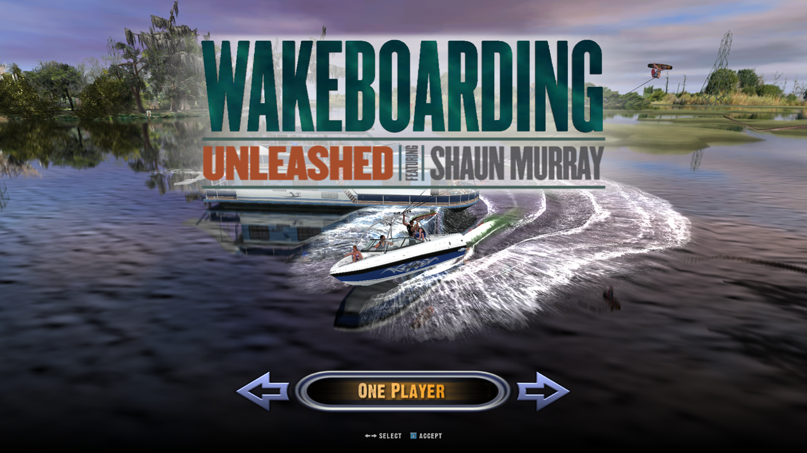
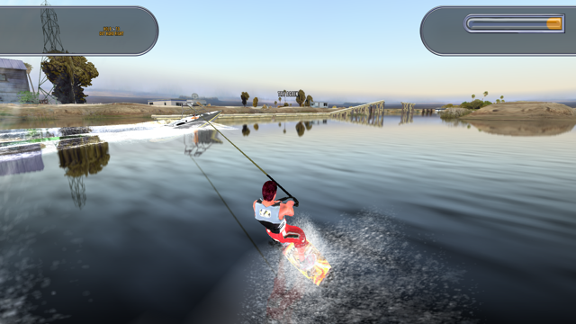

# Wakeboarding Unleashed Widescreen Fix

A drop-in fix for **Wakeboarding Unleashed featuring Shaun Murray** (PC, Activision / Aspyr, 2003) that makes it
play properly on modern widescreen displays.




## Features
- **Any resolution.** Renders at your desktop resolution by default (1920×1080, 2560×1440, 3440×1440 and so on),
  or any size you set. The original game only offered 640×480 to 1280×1024.
- **Borderless window with instant alt-tab.** No more exclusive full screen; the game pauses while unfocused, as before.
- **Hor+ field of view.** Wide screens show more at the sides instead of cropping the top and bottom.
  The fix changes the game's own camera maths, so water, reflections and culling all match the wider view.
- **Widescreen HUD.** The in-game HUD keeps its proportions and its side elements (tip panels, special meter, score)
  are anchored to the screen edges, the way modern widescreen games do it. Pieces designed to hang off the edge of the
  original 4:3 screen hang off the real screen edge, and cinematic letterbox bars span the full width.
  Prefer the whole HUD in the middle? Set `hud_layout=center`.
- **Unstretched menus, loading screens and movies.** They keep their original 4:3 layout in the middle of the screen.
- **Frame-rate cap** (60 fps by default), since the original ran in vsynced exclusive full screen.
- **Crash fix.** Stops the "realloc relocated memory block!" fatal error when changing levels or quitting
  on modern Windows.
- **Nothing on disk is changed.** All patches are applied in memory while the game runs.

Tested at 1920×1080 (16:9), 2560×1080 (21:9), 1280×720 and 1280×1024 (5:4).
At 4:3 and narrower aspect ratios the field-of-view and HUD fixes switch off and the game looks exactly as originally designed.

## Install
1. Copy `d3d8.dll` into the game's `Game` folder, next to `WBU.EXE`
   (by default `C:\Program Files (x86)\Aspyr\Wakeboarding Unleashed\Game`).
2. Start the game as usual (`START.EXE` or `Game\WBU.EXE`).

A `wbu-fix.ini` settings file is created on first run, and `wbu-fix.log` records what was patched.

## Settings (`wbu-fix.ini`)
| Setting | Default | Meaning |
|---|---|---|
| `width`, `height` | `0` | Render size; `0` uses the desktop resolution. A size smaller than the screen gives a centred window. |
| `borderless` | `1` | `1` = borderless window covering the screen, `0` = normal window with a frame. |
| `fov_fix` | `1` | `1` = Hor+ (wider view on wide screens), `0` = the original behaviour (crops top and bottom). |
| `hud_fix` | `1` | `1` = HUD, menus and movies keep their 4:3 proportions, `0` = stretched like the original. |
| `hud_layout` | `edges` | In-game HUD placement: `edges` = side elements at the screen edges, `center` = whole HUD in the 4:3 area in the middle. |
| `fps_limit` | `60` | Frame-rate cap; `0` = uncapped. |
| `log_projection`, `log_draws`, `debug_shots`, `debug_keys` | off | Troubleshooting aids, see below. |

The game's own resolution setting (in the launcher) no longer matters: every choice uses the size above.

## Uninstall
Delete `d3d8.dll`, `wbu-fix.ini` and `wbu-fix.log` from the `Game` folder.

## Compatibility
- Made for the 2003 PC release (`WBU.EXE`, 1,933,312 bytes). Before patching, the fix checks that the exe matches
  the version it was made for; if it doesn't, it does nothing and the game runs unmodified (see `wbu-fix.log`).
- Windows 10 and 11. The game must be able to start normally; this fix does not change how the game is installed or launched.
- Uses the primary monitor.

## Troubleshooting
- **Something looks wrong:** set `debug_keys=1`, start the game, press **F12** while the problem is on screen and quit.
  `Game\wbu-shot-<frame>.bmp` and the end of `wbu-fix.log` describe exactly how that frame was drawn.
  Please include both when reporting a problem.
- **Game runs too fast or slow:** try `fps_limit=0` (uncapped) or your monitor's refresh rate.
- **Doesn't seem to load:** check that `wbu-fix.log` appears next to `WBU.EXE`. If it doesn't, the dll is in the wrong folder.

## How it works
The game loads `d3d8.dll` from its own folder first. This dll forwards everything to the real Direct3D 8 and adds:
- **Resolution:** the game's resolution table (duplicated four times in the exe) is replaced with your size.
- **Window:** window creation is redirected to a borderless popup window, and the Direct3D device is created in windowed mode.
- **Field of view:** the game keeps a fixed horizontal FOV and derives the vertical one from the window shape. The fix widens
  the horizontal FOV factor used by both camera routines, so the game itself computes the original 4:3 vertical FOV.
- **HUD:** the in-game HUD is 3D geometry drawn through its own camera. With `hud_layout=edges`, elements on the left
  or right of the 4:3 layout are shifted out to the screen edges (a clip-space offset, so proportions are untouched),
  and the 2D text drawn on them moves with them. With `hud_layout=center`, off-centre elements are drawn with their 4:3
  projection inside a 4:3 viewport with clipping on, exactly as the original screen showed them.
- **2D screens and movies:** screen-space quads are squeezed into the centre 4:3 area, except screen copies and full-width fades.

## Building from source
Requires Rust with the `i686-pc-windows-msvc` target (the game is 32-bit) and the MSVC build tools.
```
rustup target add i686-pc-windows-msvc
cargo build --release
```
The target is set in `.cargo/config.toml`; the output is `target/i686-pc-windows-msvc/release/d3d8.dll`.
`package.ps1` builds a release zip in `dist/`.

## See also
[WBU Trainer](https://github.com/2extrapickles/wbu-trainer): live cheats, any model as your rider or boat, and a
career save editor. It works alongside this fix.

## License
MIT, see [LICENSE](LICENSE).

## Not affiliated
This is an unofficial fan project, not affiliated with or endorsed by Activision, Aspyr or Shaba Games.
You need your own copy of the game.
